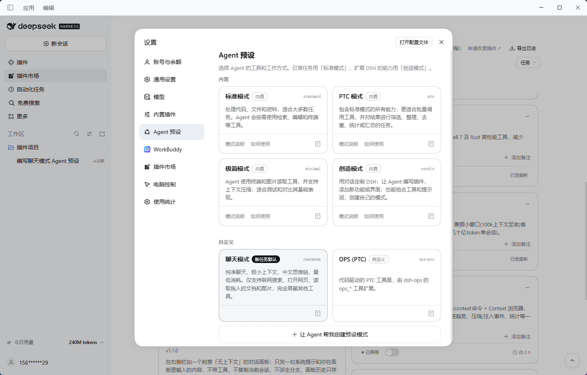
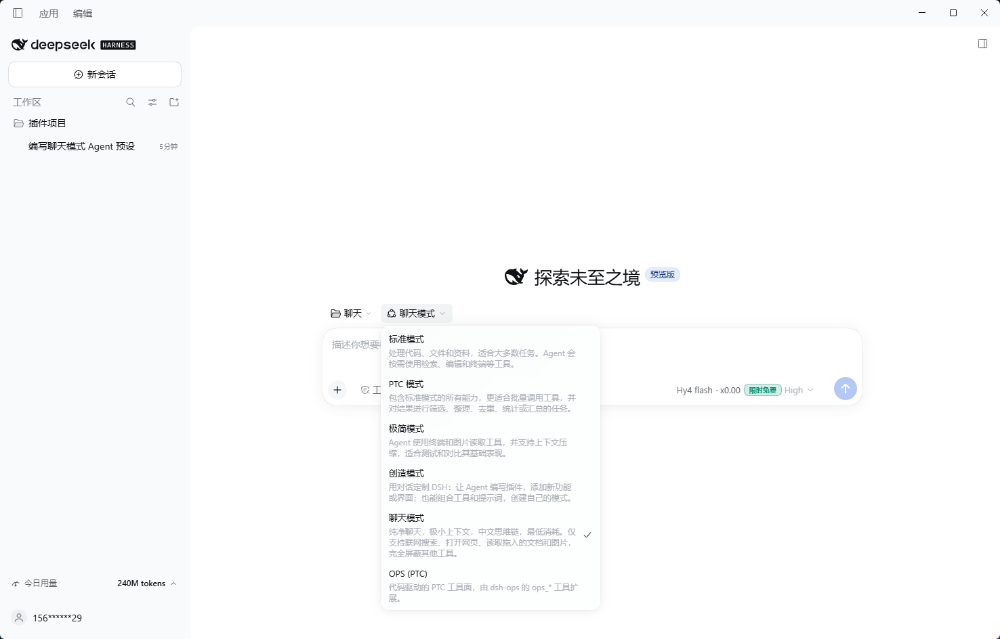

# 聊天模式 Chat Mode — DSH Agent Preset

[](https://github.com/deepseek-ai/deepseek-harness)[](https://www.npmjs.com/package/@wssdll/dsh-chat-preset)[](LICENSE)

[DeepSeek Harness（DSH）](https://www.deepseek.com/en/harness/) 的聊天专用预设，目标是把网页版那种聊天体验搬进 DSH。

**省 Token**。工具从几十个压到三个，工具 schema 从约 9 458 tok 降到约 376 tok，降低约 25 倍。系统提示只剩一段简短人设，不注入运行上下文、工作目录、Harness 检出路径这类杂项。

**保留搜索、支持附件**。保留联网搜索、打开网页、读取拖入的文档和图片。单独实现的文件读取插件，仅一行，降低工具链影响。

**时间戳**。单独实现的时间注入插件，仅一行，降低工具链影响。

**中文思维链**。内部推理固定用简体中文，回答语言跟随提问。

安装后在「设置」→「Agent 预设」→「聊天模式」启用，或新建对话时把「标准模式」切换为「聊天模式」。


## 截图





## 安装

**插件市场**：在 DSH 的「插件市场（dsh-market）」搜索 `dsh-chat-preset`。

**命令行**：

```sh
# 桌面端
dsh plugin --profile desktop add @wssdll/dsh-chat-preset
# DSH-Go / 网页端
dsh plugin --profile web add @wssdll/dsh-chat-preset
```

## 免费使用

聊天模式自带的三个工具里，只有搜索会真的花钱：`web_search` 默认走 DeepSeek 官方通道，按 token 从 DeepSeek 余额里扣，即使对话本身用的是别家模型。模型这一头也一样，官方通道按量计费。

两个第三方插件可以分别把这两笔省掉，它们都不是本预设的依赖，装不装都能正常用。

### 搜索免费：dsh-free-search

```sh
dsh plugin --profile desktop add dsh-free-search
```

装完搜索改走免费引擎，不需要任何 API key。首选引擎失败会自动换下一个，被限流的那一个会冷却一段时间再回来。

设置页在「插件」→「免费搜索」，可以选引擎、给某个引擎填 key、一键测试全部引擎。聊天框里输入 `/free-search-engine` 也能直接弹出引擎切换窗口。

要注意的是：免费引擎全部失败时它会回退到 DeepSeek 官方搜索，那一档是扣费的。不想让它回退过去，就把这两个引擎禁掉：

```yaml
- id: web-search-free
  config:
    disabledEngines:
      - deepseek-official
      - deepseek-tools
    bingMarket: zh-CN
```

### 模型免费：dsh-connect-workbuddy

```sh
dsh plugin --profile desktop add dsh-connect-workbuddy
```

装完在「设置 → WorkBuddy」里扫码登录（国际版是浏览器登录，没有二维码），登录后 WorkBuddy 的模型会出现在模型选择器里，模型名后面跟着积分倍率，比如 `GLM-5.3 · x0.79`。倍率是 `x0` 的模型不扣积分，选择器上带「限免」「夜间折扣」徽标的会按上游活动实时改价。

这个插件的原则写在它自己的说明里：每次调用花的是你自己账号的额度，不提供账号、不共享凭据、不绕过计费。

### 两个一起用

模型选 WorkBuddy 的免费档，搜索走免 key 引擎，整条链路就没有按量计费的部分了。附件读取和时间注入都由本预设自带，不额外花钱。

风险也照实说：WorkBuddy 已经开始限制非官方客户端请求，上游一旦收紧，插件可能失效。这是这类工具的常态，账号风险请自行评估。

### 关于上下文窗口

这两个插件接进来的模型，上下文窗口通常比官方小。压缩阈值 `0.16` 是**比例**不是绝对值：窗口 1M 时约 16 万 token 触发，窗口 200K 时约 3.2 万就触发，压缩后保留 8% 原文。换成小窗口模型后压缩变勤属于正常现象，不需要改配置。

## 为什么需要这个

DSH 默认的预设是给干活设计的：几十个工具、几千 token 的工具说明、一整套「你是编码代理」的提示。这些内容在写代码时有用，但在纯聊天里会持续消耗 Token，并且把人设挤到边缘。

实际聊天会话的测量：

| | 工具数 | 工具 schema |
|---|---|---|
| 未处理 | 27 | ~9 458 tok |
| 加上本插件 | **3** | **~376 tok** |

实际上语气不仅仅由人设决定，同样会受到工具链的影响。

工具链越多，多轮对话下人设越容易朝严肃、简短、直白的方向收敛。

目前市场上的类似插件，要么没有屏蔽工具链，要么不支持搜索和附件。

## 它做了什么

`cordis.patch.yml` 是核心预设文件：

- `dsh-persona`，`complete: true`：整段人设即全部系统提示，其他身份、后缀、工具引导段落一律不注入
- `includeRuntimeContext: false`：关闭运行环境上下文，聊天模式用不上
- `dsh-tool-web`：`web_search` + `web_fetch`
- `read_attachment`：读本对话的附件，Host 端强制校验，其他路径一律拒绝
- 长对话照常压缩

另外两个是本插件自带的补丁：

- `clock.js`：每小时注入一行 `当前时间：2026/11/21 23:41（周六）。`。官方的 `dsh-time-context` 每次注入三行技术描述（turn/step 编号、时区策略、距上条消息的耗时），实测会让模型把注意力放在时间戳上，所以换成了这一行纯事实。
- `no-cwd.js`：去掉工作目录的 system-reminder。`dsh-working-directory` 把这条注册成 `required: true`，`complete: true` 和 `includeRuntimeContext: false` 都拦不住它，只能在预设作用域里注册一个同名空条目把它遮掉。工作目录服务本身照常运行，其他模式不受影响。

`guard-tools.js` 屏蔽工具的脚本，自动生效，不需要任何配置。它只对 `chatmode` 预设的会话有效，其他预设完全不受影响。

注意：此脚本只能屏蔽非「agent 作用域」的工具，详情见下面的「和其他插件共存」。

## 和其他插件共存

**判定方式是白名单。** `guard-tools.js` 的 `ALLOWED` 只有三个名字，其余无论从哪来，全部进 deny 列表。所以装了新插件，它的工具默认就被排除，不需要改这里。

具体到一个工具的流向：

| 新插件把工具注册为 | 结果 |
|---|---|
| 全局工具 | 照常被屏蔽 |
| agent 作用域工具 | **屏蔽不了**（见下面的说明） |

### 关于「agent 作用域」这个例外

DSH 的工具分两层注册：

- **全局**：`ctx.tools.register(def)`，所有 agent 都看得到，`restrict()` 能挡。
- **agent 作用域**：注册在某个 agent 自己的上下文里，`restrict()` **挡不住**。这是 `dsh-tools` 的明文约定：`scoped registrations remain visible`。

也就是说，**任何在 agent 作用域里注册工具的插件，它的工具都会出现在聊天模式里**，预设和本插件都无能为力。已知的例子是 `dsh-gitbash-shell`，它会把 `bash`、`gitbash_native`、`gitbash_to_native_path` 注册进 agent 作用域。

遇到这种情况只有两个选择：关掉那个插件，或者接受它的工具出现在聊天模式里。

验证方法很简单：在聊天模式里问一句「你现在有哪些工具」，多出来的就是这类工具。

### 工具在会话中途出现怎么办

装插件或热加载时，新工具是在会话**已经跑起来之后**才注册的，早先算出的 deny 列表里没有它。

本插件监听 `tools/change`，任何工具变动都会对已加护的会话重新计算掩码，所以新出现的工具会在同一轮被压掉，不会漏到下一轮。

不过最稳妥的做法仍是：**装完插件重启 DSH，再开聊天会话。**

## 人设

`cordis.patch.yml` 里的 `prefix` 就是全部人设，可以直接改，改完热重载生效。

它沿四个方向约束说话方式：

- **语气**：友善、温暖，允许有情绪
- **风格**：反格式堆砌（清单、标题、粗体），允许口语和表情
- **诚实**：允许说不知道，不随意编造，需要最新信息会搜索。
- **语言**：思维链全中文

具体措辞以 `cordis.patch.yml` 为准。

注意：改完**已存在的会话不会更新**。DSH 的预设修订在会话创建时绑定，需要新开会话。


## 兼容性

| 项目 | 值 |
|---|---|
| DSH 版本 | `>=0.2.2-rc.1 <0.3.0-0` |
| 实际测试 | `0.2.2-rc.1` |

依赖（均为 DeepSeek Harness 官方包）：`@deepseek-ai/dsh-persona`、`@deepseek-ai/dsh-tool-web`、`@deepseek-ai/dsh-compaction-basic`。**不依赖任何第三方插件**，附件读取和时间注入都由本包自带。

`no-cwd.js` 通过 `ctx.systemPrompt.context()` 遮蔽工作目录那一节，需要 Host 提供 `systemPrompt` 服务；缺少它时这个补丁会加载失败，去掉预设里的 `chatmode-no-cwd` 那一行即可。

工具限制用到的 `agent-preset/selected`、`tools.restrict()`、`tools/change` 三个接口在整个 0.2.x 期间没有出现在任何升级指南里，但它们属于工具层。`v0.2.1-rc.2` 引入了 `ResolvedToolSet` 并重构了工具声明时序，所以更早的 0.2.0 版本不保证可用，版本下限就定在这里。

### DSH-Go 支持

在 [DSH-Go](https://github.com/ccch1mneyyy/dsh-Go) 的本机引擎里，用它的「终端」执行（App 启动引擎用的 profile 是 `web`）：

```sh
dsh plugin --profile web add @wssdll/dsh-chat-preset
```

装完点「新对话」-「预设」即可看到「聊天模式」。如果显示「加载失败/不可用」，通常是内置引擎版本低于 `0.2.2-rc.1` 导致 `engines.dsh` 不满足；可查看引擎日志确认 DSH 版本。

### DSH-Go 上免费使用

免费方案在 DSH-Go 上同样成立，前提是 App 连的是**本机引擎**：模型和搜索都跑在这台电脑上，WorkBuddy 的登录态也就在这里。DSH-Go 用的 profile 是 `web`，所以在它的「终端」里执行：

```sh
dsh plugin --profile web add dsh-free-search
dsh plugin --profile web add dsh-connect-workbuddy
```

装完重启引擎，手机端新建对话时模型选择器里应该就能看到 WorkBuddy 的模型，搜索也走免费引擎。WorkBuddy 的登录在电脑上完成，插件读的是本机的登录态。

如果 DSH-Go 连的是云端引擎，就没有本机的 WorkBuddy 登录态，模型那一半用不了；搜索那一半仍然有效，因为免费搜索插件本身不需要登录。

